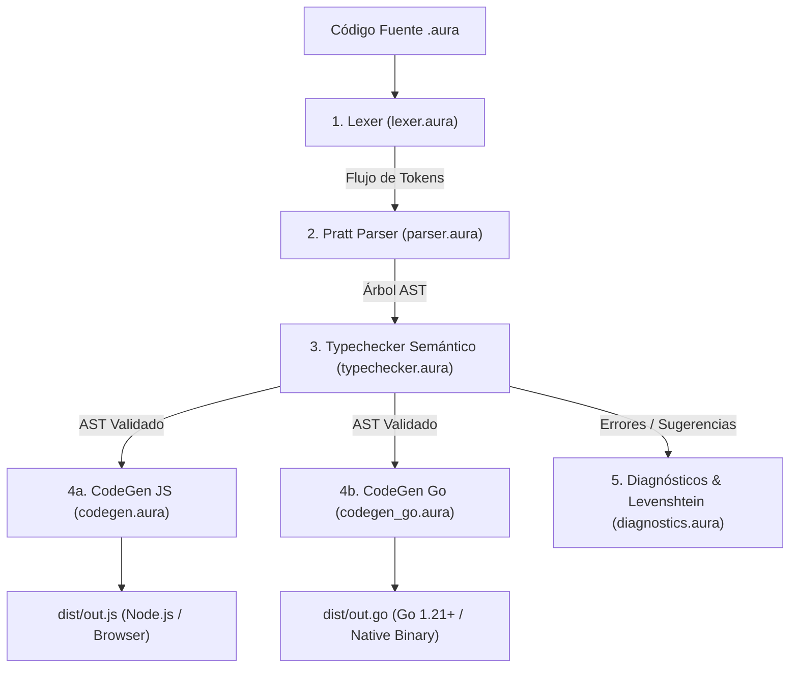

# 🛠️ Guía Práctica: Cómo Agregar Nuevas Features al Compilador Self-Hosted de Aura (`aura_compiler`)
*Practical Guide: How to Extend and Add New Language Features Using Aura's Self-Hosted Compiler*

Esta guía explica en detalle y paso a paso la arquitectura del compilador autohospedado de Aura (`src/aura_compiler/`), demostrando cómo un desarrollador puede diseñar, implementar, verificar y compilar una nueva característica del lenguaje (por ejemplo: un nuevo operador binario, una nueva sentencia de control como `assert`, o una nueva expresión) directamente en código Aura puro.

---

## 🏛️ Pipeline Modular de 5 Capas

El compilador de Aura implementa una arquitectura desacoplada donde cada etapa es un módulo independiente en `src/aura_compiler/`:



---

## 🚀 Flujo Paso a Paso para Agregar una Nueva Característica

Imaginemos que queremos agregar la sentencia `assert <condición>, "<mensaje>"` o un nuevo operador aritmético/lógico `**` (exponenciación) al lenguaje. A continuación se detallan los pasos exactos en cada archivo:

---

### Paso 1: Definir la Estructura en el AST ([`ast.aura`](../../src/aura_compiler/ast.aura))

En `ast.aura`, añade la variante en los tipos suma algebraicos (`type ExprNode` o `type StmtNode`):

```aura
// En src/aura_compiler/ast.aura:

/// Nueva variante de sentencia para validación estática/dinámica
export type StmtNode =
  | StmtLet { name: String, isMut: Bool, annot: Option<TypeNode>, val: ExprNode }
  | StmtAssign { target: String, val: ExprNode }
  | StmtReturn { val: Option<ExprNode> }
  | StmtExpr { expr: ExprNode }
  | StmtAssert { cond: ExprNode, message: Option<String> } // ✨ NUEVA FEATURE
```

---

### Paso 2: Agregar Reconocimiento Léxico en el Lexer ([`lexer.aura`](../../src/aura_compiler/lexer.aura))

En `lexer.aura`, añade el token a `TokenKind` y la regla en el escáner de palabras clave:

```aura
// 1. En ast.aura / lexer.aura:
export type TokenKind =
  | TAssert // ✨ Nuevo token
  | ...

// 2. En la función tokenize() de lexer.aura:
let kind = match ident {
  "assert" => TAssert, // ✨ Reconocimiento de palabra clave
  "let" => TLet,
  "fn" => TFn,
  ...
};
```

---

### Paso 3: Implementar la Regla Gramatical en el Pratt Parser ([`parser.aura`](../../src/aura_compiler/parser.aura))

En `parser.aura`, agrega el método o rama para consumir el token y construir el nodo del AST:

```aura
// En parseStatement(p: Parser): Result<StmtNode, String>
if (matchToken(p, TAssert)) {
  let cond = parseExpr(p)?;
  let mut message = None;
  if (matchToken(p, TComma)) {
    let msgTok = advance(p);
    match msgTok {
      TString { value } => { message = Some(value); },
      _ => { return Err("Expected string message after comma in assert"); }
    }
  }
  matchToken(p, TSemicolon);
  return Ok(StmtAssert { cond: cond, message: message });
}
```

---

### Paso 4: Validar Semántica y Tipos en el Typechecker ([`typechecker.aura`](../../src/aura_compiler/typechecker.aura))

En `typechecker.aura`, valida que la condición sea booleana (`STyBool`) dentro del entorno léxico (`TypeEnv`):

```aura
// En checkStmt(env: TypeEnv, stmt: StmtNode): Result<SemanticType, String>
match stmt {
  StmtAssert { cond, message: _ } => {
    let condTy = inferExpr(env, cond)?;
    if (!unifyTypes(condTy, STyBool)) {
      return Err("Type Error [E0308]: assert condition must evaluate to Bool");
    }
    Ok(STyUnit)
  },
  ...
}
```

---

### Paso 5: Emitir Código en los Generadores JS y Golang

#### 5a. Emisión de JavaScript ES6 ([`codegen.aura`](../../src/aura_compiler/codegen.aura))
```aura
// En stmtToJs(stmt: StmtNode): String
StmtAssert { cond, message } => {
  let c = exprToJs(cond);
  let msg = match message {
    Some(m) => `"${m}"`,
    None => `"Assertion failed: ${c}"`
  };
  `if (!(${c})) { throw new Error(${msg}); }`
}
```

#### 5b. Emisión de Golang 1.21+ ([`codegen_go.aura`](../../src/aura_compiler/codegen_go.aura))
```aura
// En stmtToGo(stmt: StmtNode): String
StmtAssert { cond, message } => {
  let c = exprToGo(cond);
  let msg = match message {
    Some(m) => `"${m}"`,
    None => `"Assertion failed"`
  };
  `if !(${c}) { panic(${msg}) }`
}
```

---

### Paso 6: Ciclo de Re-Bootstrapping y Pruebas

Una vez realizadas las modificaciones en los archivos `.aura` de `src/aura_compiler/`:

1. **Recompilar el compilador autohospedado con el compilador Rust de referencia (`aurac`)**:
   ```bash
   aurac compile src/aura_compiler/ast.aura -o dist/ast.mjs
   aurac compile src/aura_compiler/lexer.aura -o dist/lexer.mjs
   aurac compile src/aura_compiler/parser.aura -o dist/parser.mjs
   aurac compile src/aura_compiler/typechecker.aura -o dist/typechecker.mjs
   aurac compile src/aura_compiler/codegen.aura -o dist/codegen.mjs
   aurac compile src/aura_compiler/codegen_go.aura -o dist/codegen_go.mjs
   aurac compile src/aura_compiler/main.aura -o dist/aurac.mjs
   ```

2. **Probar tu nuevo programa con el compilador autohospedado recién generado (`dist/aurac.mjs`)**:
   ```bash
   # Compilar a JavaScript
   node dist/aurac.mjs mi_programa.aura -o dist/mi_programa.js --target js
   node dist/mi_programa.js

   # Compilar a Golang
   node dist/aurac.mjs mi_programa.aura -o dist/mi_programa.go --target go
   go run dist/mi_programa.go
   ```

3. **Construir el binario nativo independiente con la nueva feature integrada**:
   ```bash
   aurac build src/aura_compiler/main.aura -o dist/aura-self-hosted
   ./dist/aura-self-hosted mi_programa.aura -o dist/salida.js
   ```

4. **Validar la suite de pruebas de bootstrap**:
   ```bash
   cargo test --test bootstrap_tests -- --test-threads=1
   ```

---

## 📂 Ejemplos Incluidos en este Directorio

- [`demo_extended_feature.aura`](demo_extended_feature.aura): Programa de prueba que demuestra el uso de funciones puras, expresiones matemáticas con jerarquía completa de operadores, bucles iterativos y pipelines.
